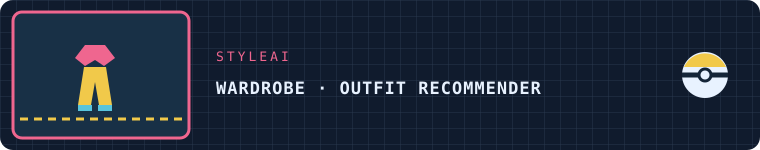
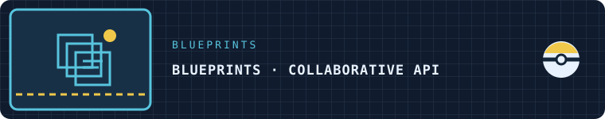
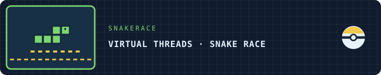
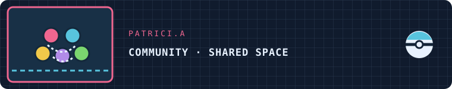
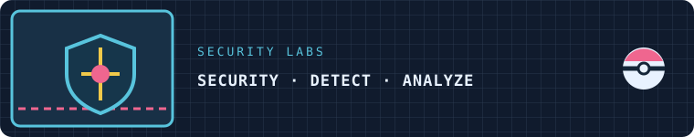
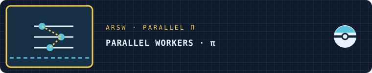
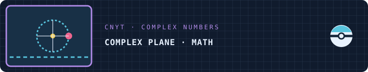
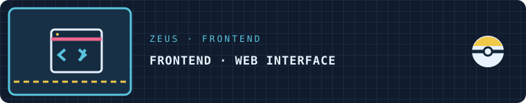

<h3>SOFTWARE DEVELOPMENT · AI / MACHINE LEARNING · COLOMBIA</h3>

   

[Profile](#profile) · [Tech Stack](#tech-stack) · [Projects](#projects) · [Analytics](#analytics) · [Contact](#contact)

---

## Profile 

Software Engineering student in Colombia interested in building useful products and learning through collaboration. My public projects explore frontend, backend, applied AI, concurrency, and security.

## Battle Arena

---

## Tech Stack 

**Backend**

    

**Frontend**

    

**Data · AI · Testing**

     

**Security · Systems**

    

---

## Featured Projects 

<table>
<tr>
<td width="50%" align="center" valign="top">

### StyleAI

AI outfit recommender and digital wardrobe with web app, API, and recommendation experiments.

**React · FastAPI · Transformers · PyTorch**

[Repository](https://github.com/DiegoFabianAndrade/StyleAI)

</td>
<td width="50%" align="center" valign="top">

### BluePrints

Collaborative REST API for blueprint models, identity, redundancy, and undersampling filters.

**Java 21 · Spring Boot · PostgreSQL · OAuth2/JWT**

[Repository](https://github.com/DiegoFabianAndrade/BluePrints)

</td>
</tr>
<tr>
<td width="50%" align="center" valign="top">

### DOSW Library

Library system for books, users, and loans with relational and document persistence.

**Java · Spring · JPA · PostgreSQL · MongoDB**

[Repository](https://github.com/DiegoFabianAndrade/DOSW-Library)

</td>
<td width="50%" align="center" valign="top">

### SnakeRace

Autonomous snake race with synchronization, concurrency, obstacles, and desktop UI.

**Java 21 · Virtual Threads · Swing**

[Repository](https://github.com/DiegoFabianAndrade/SnakeRace)

</td>
</tr>
<tr>
<td width="50%" align="center" valign="top">

   

### PATRICI.A

Student community platform built collaboratively; frontend contributions in the shared repository.

**React · TypeScript · Zustand · Tailwind**

[Repository](https://github.com/DiegoFabianAndrade/PATRICI.A-FRONT-END)

</td>
<td width="50%" align="center" valign="top">

### Security Labs

Academic work in hardening, traffic and log analysis, detection, and binary analysis.

**Nginx · SIEM · Ghidra · GDB**

[Repository](https://github.com/DiegoFabianAndrade/LAB_3_FDSI_AMADOR_ANDRADE)

</td>
</tr>
</table>

<b>More projects</b>

<table>
<tr>
<td width="50%" align="center">

[ARSW · Parallel π](https://github.com/DiegoFabianAndrade/ARSW)
</td>
<td width="50%" align="center">

[CNYT · Complex Numbers](https://github.com/DiegoFabianAndrade/Trabajo-CNYT)
</td>
</tr>
<tr>
<td width="50%" align="center">

[DOSW · Learning Log](https://github.com/DiegoFabianAndrade/BITACORA_DOSW)
</td>
<td width="50%" align="center">

[Zeus · Frontend](https://github.com/DiegoFabianAndrade/Vite_Zeuz_Codensa)
</td>
</tr>
</table>

## Bonus Stage

---

## GitHub Analytics 

 

[Full activity](https://github.com/DiegoFabianAndrade?tab=overview) · [Repositories](https://github.com/DiegoFabianAndrade?tab=repositories)

## Contact 

  

---

*Pokémon sprites via [PokeAPI Sprites](https://github.com/PokeAPI/sprites). Pokémon and its characters are owned by their respective rights holders; this personal profile is not officially affiliated or sponsored.*

