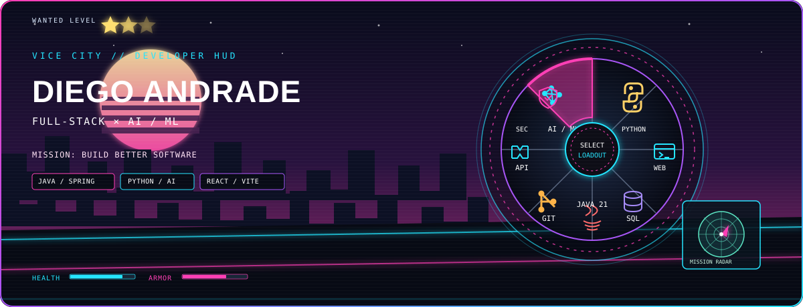

**FULL-STACK DEVELOPER · AI/ML EXPLORER · TEAM BUILDER**

*ES 🇨🇴 / EN 🇬🇧 · Misión actual: convertir ideas en software útil.*

---

## 🇪🇸 Sobre mí / About me

Soy **Diego Andrade**, desarrollador en formación enfocado en **Full-stack e Inteligencia Artificial / Machine Learning**. Me gusta construir aplicaciones de extremo a extremo: interfaces web, APIs, servicios backend y prototipos que exploran cómo los modelos de IA pueden resolver problemas reales.

- 🧩 **Full-stack:** React, TypeScript, JavaScript, HTML/CSS y herramientas modernas de frontend.
- ☕ **Backend:** Java 21, Spring Boot, APIs REST, PostgreSQL y documentación OpenAPI/Swagger.
- 🧠 **IA/ML:** Python, FastAPI, Transformers, PEFT/QLoRA y experimentación con modelos de lenguaje.
- 🤝 **Colaboración:** proyectos de equipo, pull requests, documentación y mejora iterativa.
- 🎮 **Mi HUD:** estética de videojuegos open-world, ciudades neón y referencias visuales a los clásicos de acción urbana.

**EN —** I'm Diego Andrade, a developer-in-progress focused on **full-stack engineering and AI/ML**. I enjoy building end-to-end applications across web interfaces, APIs, backend services, and AI-powered prototypes. I value collaborative development, clear documentation, and learning by shipping real projects.

> **MISSION / MISIÓN:** Build. Learn. Ship. Repeat.

## 🎮 Select your loadout / Selecciona tu arsenal

La rueda superior es una reinterpretación original del **selector radial de equipamiento de los videojuegos open-world**: cada ranura representa una herramienta de desarrollo en vez de un arma real. La estética usa un HUD, estrellas de búsqueda, radar, skyline y neón para comunicar la temática de inmediato, sin usar logotipos ni arte oficial.

The animated wheel is an original **open-world game-style loadout selector**: each slot represents a developer tool rather than a real weapon. The HUD, wanted stars, radar, skyline, and neon palette make the game inspiration immediately recognizable without using official logos or artwork.

## 🧰 Tech stack / Tecnologías

Las insignias combinan tecnologías que aparecen en los archivos de los proyectos revisados y áreas que estoy explorando. No implican el mismo nivel de dominio en todas ellas.

Badges combine technologies found in inspected project files with areas I'm exploring; they do not imply equal proficiency in every tool.

**Languages / Lenguajes**

**Frontend / Interfaz**

**Backend / APIs**

**AI / ML**

**Workflow / Flujo de trabajo**

## 🚘 Featured missions / Proyectos destacados

<table>
<tr>
<td width="50%" valign="top">

### 🧠 StyleAI — AI outfit recommender
**[Repository ↗](https://github.com/DiegoFabianAndrade/PROYECTO-PTIA-STYLEAI-DIEGO-ANDRADE)**

**ES:** Sistema de recomendación de outfits que combina gestión digital de armario, contexto climático, ocasión y preferencias. El repositorio documenta un prototipo web, un backend FastAPI, dataset sintético y experimentación con fine-tuning de LLM.

**EN:** An outfit recommendation system combining a digital wardrobe, weather/context, occasion, and style preferences. The repo documents a web prototype, FastAPI backend, synthetic dataset, and LLM fine-tuning experiments.

`Python` `FastAPI` `Transformers` `PEFT/QLoRA` `HTML/CSS/JS`

</td>
<td width="50%" valign="top">

### ☕ BluePrints REST API — Java 21
**[Repository ↗](https://github.com/DiegoFabianAndrade/Lab_P1_BluePrints_Java21_API_Andrade_Melo)**

**ES:** Proyecto de API REST con Spring Boot, PostgreSQL, validación, seguridad y documentación OpenAPI/Swagger. El historial público incluye merges asociados a versionamiento de endpoints, persistencia, filtros y configuración Swagger.

**EN:** A Java 21 REST API project using Spring Boot, PostgreSQL, validation, security, and OpenAPI/Swagger documentation. Public history includes merge commits related to API versioning, persistence, filtering, and Swagger setup.

`Java 21` `Spring Boot` `REST` `PostgreSQL` `OpenAPI`

</td>
</tr>
<tr>
<td width="50%" valign="top">

### 🌆 Zeus Codensa — Web frontend
**[Vite repository ↗](https://github.com/DiegoFabianAndrade/Vite_Zeuz_Codensa)** · [Team frontend repository ↗](https://github.com/Maria-Jose-Perez-Zamora/Zeus-Codensa-Front-End)

**ES:** Trabajo frontend con Vite, React y TypeScript. El historial de PR público muestra trabajo en estructura del proyecto, pantallas, landing/feed y documentación de arquitectura.

**EN:** Frontend work with Vite, React, and TypeScript. Public PR history includes project structure, screens, landing/feed work, and architecture documentation.

`React` `TypeScript` `Vite` `Team collaboration`

</td>
<td width="50%" valign="top">

### 🐍 SnakeRace — Java 21
**[Repository ↗](https://github.com/DiegoFabianAndrade/Lab_SnakeRace-Java21-Andrade-Melo-Parte1)**

**ES:** Proyecto colaborativo en Java que refleja práctica de programación orientada a objetos y desarrollo incremental.

**EN:** A collaborative Java project showcasing object-oriented programming practice and incremental development.

`Java 21` `OOP` `Collaboration`

</td>
</tr>
<tr>
<td width="50%" valign="top">

### 🧩 PATRICI.A — Frontend collaboration
**[Team repository ↗](https://github.com/PATRICI-A/PATRICI.A-FRONTEND)**

**ES:** Repositorio de equipo con pull requests públicos vinculados a eventos, landing page y feed. Consulta los PR enlazados abajo para revisar el alcance exacto.

**EN:** Team repository with public pull requests related to events, the landing page, and feed. See the linked PRs below for the exact scope.

`Frontend` `Pull requests` `Teamwork`

</td>
<td width="50%" valign="top">

### 📚 More projects / Más proyectos
- [DOSW Library](https://github.com/DiegoFabianAndrade/DOSW-Library)
- [BITACORA DOSW](https://github.com/DiegoFabianAndrade/BITACORA_DOSW)
- [ARSW first-cut project](https://github.com/DiegoFabianAndrade/ARSW-2026-02-ParcialPrimerCorte-DiegoFabianAndrade)
- [Trabajo CNYT](https://github.com/DiegoFabianAndrade/Trabajo-CNYT)

</td>
</tr>
</table>

## 🤝 Verified collaboration / Colaboración verificable

Revisé el historial público de pull requests que GitHub devuelve para el autor `DiegoFabianAndrade`. Encontré PRs en los repositorios de Zeus Codensa y PATRICI.A; los enlaces siguientes permiten verificar el título, los cambios y el estado en GitHub. **No asumo que todos estén fusionados ni que seas autor de todo el código de esos repositorios.**

I checked the public pull-request search results for `DiegoFabianAndrade`. The following links point to PRs in the Zeus Codensa and PATRICI.A repositories. **This does not imply every PR was merged or that you authored all code in those repositories.**

<b>Zeus Codensa — frontend PRs</b>

- [#15 — Finalización de pantallas y tareas frontend](https://github.com/Maria-Jose-Perez-Zamora/Zeus-Codensa-Front-End/pull/15)
- [#14 — Develop](https://github.com/Maria-Jose-Perez-Zamora/Zeus-Codensa-Front-End/pull/14)
- [#13 — Implementación de pantallas](https://github.com/Maria-Jose-Perez-Zamora/Zeus-Codensa-Front-End/pull/13)
- [#12 — Implementación de tareas frontend](https://github.com/Maria-Jose-Perez-Zamora/Zeus-Codensa-Front-End/pull/12)
- [#11 — Documento de arquitectura](https://github.com/Maria-Jose-Perez-Zamora/Zeus-Codensa-Front-End/pull/11)
- [#10 — Documento de arquitectura](https://github.com/Maria-Jose-Perez-Zamora/Zeus-Codensa-Front-End/pull/10)
- [#4 — Estructura del repositorio Vite frontend](https://github.com/Maria-Jose-Perez-Zamora/Zeus-Codensa-Front-End/pull/4)
- [#9 — Actualización del README de requerimientos (Zeus Codensa)](https://github.com/Maria-Jose-Perez-Zamora/Zeus-Codensa/pull/9)
- [#5 — Configuración `application.yaml` / `pom.xml`](https://github.com/Maria-Jose-Perez-Zamora/Zeus-Codensa/pull/5)

<b>PATRICI.A — frontend PRs</b>

- [#36 — Feature/eventoss](https://github.com/PATRICI-A/PATRICI.A-FRONTEND/pull/36)
- [#26 — Finalización del feed y landing page](https://github.com/PATRICI-A/PATRICI.A-FRONTEND/pull/26)
- [#17 — Feature/landing page](https://github.com/PATRICI-A/PATRICI.A-FRONTEND/pull/17)

## 📊 Live stats / Estadísticas en vivo

These cards are third-party, dynamically generated summaries of public GitHub data. They can be cached, and language cards measure code distribution rather than proficiency.

## 🎯 Next missions / Próximas misiones

- [ ] Fortalecer tests, CI/CD y despliegues de proyectos.
- [ ] Documentar arquitectura, decisiones técnicas y resultados medibles.
- [ ] Seguir explorando LLMs, inferencia y sistemas full-stack.
- [ ] Compartir más demos y proyectos listos para probar.

## 📡 Connect / Contacto

---

*“The city is open. The next mission is yours.”*  
*«La ciudad está abierta. La siguiente misión es tuya».*

Fan-inspired visual theme. Original artwork; not affiliated with or endorsed by Rockstar Games.

